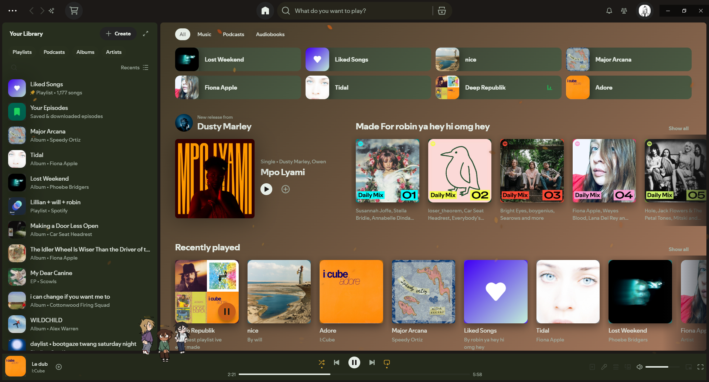

# forest

because green

## Features

* greeninspired color palette
* Falling green petals
* Dark atmospheric wallpaper included (off google)
* Clean recommendation section
* Soft green accent colors

## Installation

Copy forest into:

%appdata%\Roaming\spicetify\Themes

Then run:

spicetify config current_theme forest

spicetify config inject_theme_js 1

spicetify apply

-- made by [siqnole](https://siqnole.dev) 💜
